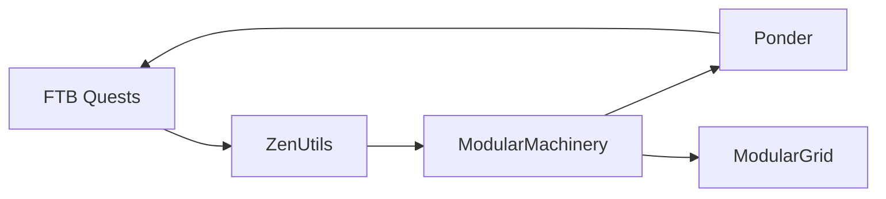

# 加载顺序与编辑性能

## 这次的依赖环

用户日志中的箭头表示“先加载，再加载”：

ZenUtils 声明在 Quests 后加载，ModularMachinery 在 ZenUtils 后，Ponder 在 ModularMachinery 后；旧 Quests 又声明在 Ponder 后，因此没有任何可行顺序。ModularGrid 依赖 ModularMachinery，是受阻的下游；日志 `Likely cycle` 列表并不表示列表中的所有 Mod 都组成了环。

`after:` 虽然不要求对方必须安装，但安装时会产生强制排序边。两个 Mod 没有直接互相依赖，也可能通过第三、第四个 Mod 形成环。

modern.13 移除 Quests 的 `after:ponder-legacy`。任务中的教程入口只在加载完成后的客户端界面调用 Ponder，不需要按 Mod 启动先后排列。Ponder 仍是 compileOnly 依赖，检测已加载后才进入独立客户端桥接类；未安装时显示提示。任务系统的必装前置和确实在初始化阶段调用的兼容项保留原排序。

## 处理同类问题

1. 根据日志或实际 JAR 的 `@Mod` / 生效的 `mcmod.info` 还原所有 `before`、`after`、`required-before`、`required-after` 边。区分参与闭环的节点与被阻塞的下游。
2. 检查每一条可选排序边实际在哪个阶段使用。仅在 UI、命令或玩家行为中调用的兼容通常可以延后到使用时；两个 Mod 都完成初始化后才需要的连接，可放在加载完成阶段。
3. 真实必装 API 保持依赖。可选类型隔离到兼容包，仅在加载检测成功后调用；注意客户端和专服隔离。移除排序边后，仍须验证 API 可用时机。
4. 用 Forge 自身的排序器验证完整链，改变输入顺序验证稳定性，再运行实际安装产物的客户端、专服和可选功能。更改 JAR 文件名不能消除声明中的依赖环。

本项目的 `OptionalIntegrationSortingTest` 直接读取编译后任务入口的注解，用日志中的 ZenUtils / ModularMachinery / Ponder / ModularGrid 声明构图，复现旧版错误并检查修复。测试中的这些节点为排序夹具，不将其当作真实 Mod 联动验收。真实 Ponder 1.6.2 的搜索、指定动画、图文页及返回任务书另在正式 CR 0.4.0 验证。

## 新增节点的延迟

旧创建路径为每个回复执行 `refreshIDMap()`，其内部会两次清除整本显示与进度缓存；服务端还有额外的全量清理。右键创建一个带任务的节点有任务、子任务两个回复，因此大量已有节点的图标和文字会被反复计算。

modern.13 用 `registerCreatedObject()` 登记单个 ID，更新关联任务、章节祖先的派生图标和进度缓存。画布只插入新按钮或更新所属任务按钮，保留其他节点的标题、图标、按钮、视口、选择和 JEI 实例。整本加载和结构性批量操作继续使用完整索引刷新。没有修改 ID 或保存格式。

性能验收创建 2000 个任务、各配物品任务和奖励，安装真实 HEI，测量实际创建数据包到首个画布渲染帧；同时记录服务端首次回复和客户端回复处理耗时。与旧 JAR 在隔离场景中对照。具体数值在 [验收报告](../verification/REPORT.md)，帧率、服务端 tick、整合包其他 Mod 和网络延迟都会影响最终体验。

## 内存缓存与写盘

任务定义本来就存放在服务端内存中。`ServerQuestFile.save()` 设置 `shouldSave` 并标记 Universe 为脏，不立即写文件。世界保存触发的 Universe 保存事件写任务文件；正常卸载还有强制保存。写盘继续使用已有的事务存储，保留未知字段和旧布局。

因此本次先修复创建时的全量重建。没有把可变游戏对象直接交给后台线程，也没有另建一套任务缓存格式。正常退出会保存待写数据；进程崩溃不能视为正常退出。

## 侧边栏速度

`config/ftbquests/client.cfg` 新增 `sidebarAnimationMilliseconds`，默认 **350**，可在右下角“显示设置 → 侧边栏动画时长（毫秒）”调整，范围 30～1500 ms。侧边图标缩放、辉光和章节浮层共用此值。已有的通用 `smoothingMilliseconds=140` 控制其他动画，不会覆盖这个新默认值。
