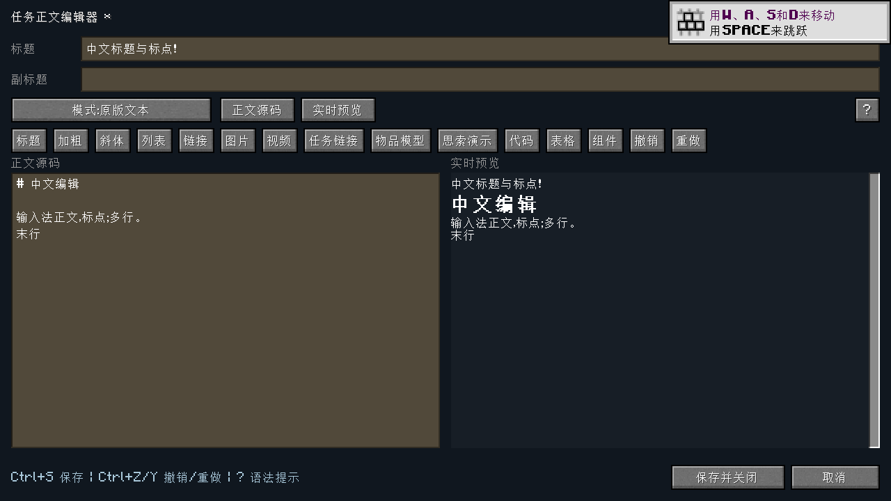

# modern.17 发行验收

正式版：[v1202.10.0-modern.17](https://github.com/mcyudream/ftb-quests-legacy/releases/tag/v1202.10.0-modern.17)。发布源码提交：`b404c451132f0b10b271f30c28b7ff91e5ee639d`。

## 修复与回归范围

- 用户提供的 [Windows 崩溃日志](https://mclo.gs/rIdlseh) 中，保存任务时重命名正在使用的 `normal` 目录触发 `AccessDeniedException`，异常进入世界自动保存。现保持任务根目录不动，备份后逐个提交有变化的文件；失败回滚，保留待保存状态并间隔 5 秒重试。
- 中文编辑移除外部系统窗口、“中”按钮和 F4 入口。Unicode 字符直接提交到原输入框；补充汉字作为完整字符插入、撤销与重做。物品／思索拼音选择器保留。
- 旧 SNBT / NBT 布局、任务 ID、团队 UID、进度和领奖记录保持兼容。运行测试使用用户任务书的独立副本，未改动原游戏实例；确认保存重读后原任务书和未知扩展字段保留。

## 构建和正式发布文件

- [源码 CI](https://github.com/mcyudream/ftb-quests-legacy/actions/runs/42419157637)：Quests 87、Library 13、专服补丁 2 项单元测试通过，共 102 项。
- [标签 CI](https://github.com/mcyudream/ftb-quests-legacy/actions/runs/42419746540)：Linux 构建、Windows 存储检查、正式 Release 发布均成功。
- 发布的 11 个文件全部重新下载并检查 SHA-256，与上述源码 CI 文件逐字节一致。实际运行验收使用的四个生产 JAR 哈希与 Release 一致。完整下载地址、哈希、CI 与运行用例见 [published.json](published.json)。
- 客户端／服务端一并更新 Quests modern.17、Library modern.5；使用 Utilities 时也替换本次重新编译的 modern.2 JAR。

## Windows 原生文件锁

标签 CI 的 `windows-latest` / Java 25 使用生产 `TransactionalStorage` 和真实 Windows 文件锁验证：[输出](windows-storage.txt)。

1. 另一个进程把工作目录设在 `normal`，复现旧目录重命名失败。
2. 目录被占用，未改动的附属文件以 `NOSHARE_DELETE` / `NOSHARE_WRITE` 打开时，保存成功。
3. 锁住待修改文件，验证先前写入回滚、新建文件移除和完整暂存快照保留；解锁后重试成功。

这是 Windows 文件系统回归；未在 Windows 上启动完整整合包。

## 正式 Cleanroom 0.4.0 客户端和专服

均为 Minecraft 1.12.2 / **Cleanroom 0.4.0（不带 alpha）** / Java 25、Linux x86_64，使用正式运行环境，`userdev: false`。两个进程退出码均为 0，结果 `FUNCTIONAL_PASS`。

| 环境 | 可选依赖 | 证据 |
| --- | --- | --- |
| 客户端与集成服务器 | Ponder Legacy 1.6.3；未安装 Media API | [运行结果](inline-input-client/result.json)、[实际 JAR](inline-input-client/runtime.json)、[输入检查](inline-input-client/input-checks.json)、[保存检查](inline-input-client/storage-checks.json) |
| 专用服务器 | 无 Ponder、Media API、MCP；安装本次发布的正式 CR 0.4.0 专服隔离补丁 | [运行结果](dedicated-server/result.json)、[实际 JAR](dedicated-server/runtime.json)、[保存检查](dedicated-server/storage-checks.json) |

两个环境均通过真实世界自动保存入口制造 I/O 失败，确认异常未逃逸、内存编辑保留、原磁盘数据未被覆盖；解除写入阻碍后，通过 Forge 服务端 Tick 触发 5 秒重试，随后完整重读验证内容，确认任务根目录标识未变。

客户端通过实际游戏 `Keyboard.addCharEvent` 队列验证标题、搜索、多行正文的中文提交、补充汉字撤销／重做、原按钮位置和 F4 均未创建外部窗口。验证了物品与思索全拼／首字母查找、选择返回准确对象，以及中文任务正文经网络与磁盘往返保存。

**系统输入法引擎的真实候选词按键流程尚未自动化实测。** 上述游戏字符队列验收不代表 Windows/macOS 输入法或完整整合包验收。

