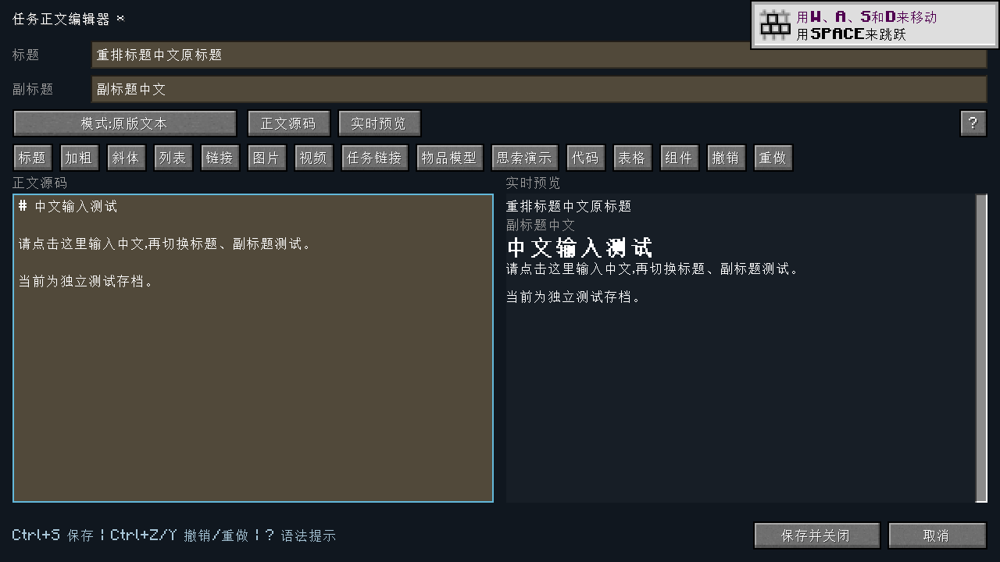

# modern.18 输入回归记录

## 已复现和修复

旧版 modern.17 / Library modern.5 的真实打包 JAR 在正式 Cleanroom 0.4.0 上复现：上一帧鼠标位于标题，下一次点击正文第二行时，光标停在第一行末尾（位置 6），实际应为第二行开头（位置 7）。`GuiWrapper` 只更新悬停标记，光标定位却读取旧坐标。证据见 [旧版失败结果](baseline/result.json)。

修复点击坐标后，还统一了单行／多行输入控件的焦点所有权。每个界面只保留一个文本输入目标，点击按钮或面板时也释放旧输入框焦点。编辑器重排保留当前输入目标，子窗口关闭后按当前界面更新按键重复状态。补充汉字的光标移动、选择、换行与替换保留完整 Unicode 字符。

## 自动化检查

| 范围 | 操作与验证 |
| --- | --- |
| 标题、正文、副标题 | 从上一帧标题位置直接点击正文第二行，投递真实游戏字符队列；检查插入行和其他字段均正确，依次切换三个输入框 |
| 窗口与视图 | 标题获得焦点后缩窄再恢复窗口，检查焦点唯一、输入目标保留；Tab 切换；预览区域点击后不接收输入 |
| 组件表单 | 点击标签、目标 ID、悬停文本三个字段输入；程序切换焦点时也只保留一个输入目标 |
| 任务搜索 | 从组件表单打开任务选择器，输入中文并返回，保留组件字段和正文草稿 |
| 物品搜索 | 点击搜索框，中文“铁锭”和拼音 `tieding` 均找到铁锭，返回后正文未被搜索内容改写 |
| 思索搜索 | 用首字母 `nyhxjgdj` 找到“能源核心结构搭建”，选择返回准确场景 ID，正文保持原样 |
| 上下文菜单 | 打开菜单时释放输入焦点，阻止文字写入底层；Esc 关闭菜单后恢复正文焦点 |
| Unicode | 单行左右移动后插入不会拆开补充汉字；多行换行、鼠标选择、替换和撤销／重做保持完整字符 |
| 保存 | 中文标题、副标题、正文经真实网络提交后完整读写重载，保留未知扩展字段 |

单元测试共 **104 项通过**（Quests 89 / Library 13 / 专服补丁 2），零失败、零跳过；新增的两个单元测试覆盖补充汉字的换行／点击位置和选择替换／撤销。见 [构建记录](build.json)。

[源码 CI](https://github.com/mcyudream/ftb-quests-legacy/actions/runs/42459684559) 的 Linux 构建、104 项测试、验收 Harness 编译／重混淆及 Windows 原生文件锁检查均通过。云端的四个生产 JAR 已下载并验证 SHA-256，与下述实际游戏验收文件一致：[云端文件校验](cloud-build.json)。

真实客户端回归见 [focus-checks.json](client/focus-checks.json) 和 [acceptance.json](client/acceptance.json)。客户端完成自动化检查后保留正文编辑器供用户测试，未自动关闭；**这里没有声称客户端已经退出或人工输入法测试已经通过**。

## 运行环境与产物

- Minecraft 1.12.2 / **Cleanroom 0.4.0 正式版，不带 alpha** / Java 25，Linux x86_64，正式安装环境，`userdev: false`。
- 客户端安装 Quests modern.18、Library modern.6、重新编译的 Utilities modern.2、ItemFilters 1.0.4.2、可选 Ponder 1.6.3。安装文件与哈希见 [客户端 runtime.json](client/runtime.json)。
- 专服未安装 Ponder、Media API、MCP，安装独立 CR 0.4.0 客户端隔离补丁。启动、任务完整保存重读通过，退出码 0，结果 `FUNCTIONAL_PASS`：[结果](server/result.json)、[运行文件](server/runtime.json)。
- 用户原整合包任务书仅复制到独立测试目录；没有修改原实例、任务定义或进度。新建测试章节和存档均位于副本。
- CI 构建新增验收 Harness 的编译和重混淆，避免验收代码失去编译检查；CI 的 Linux 单元测试和 Windows 存储检查与本地实际游戏回归分别记录。

**真实系统输入法候选词按键流程留给用户在已启动的窗口中测试。** 游戏字符队列检查不能替代 Windows/macOS 输入法实测或完整整合包验收。

